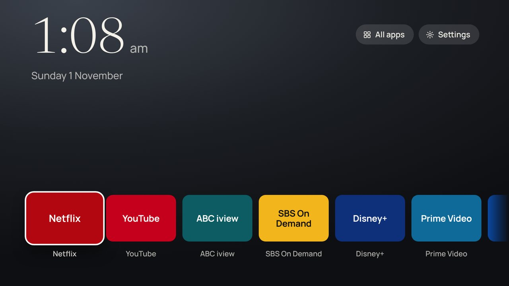
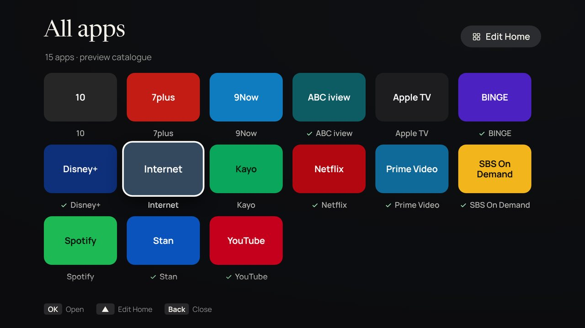
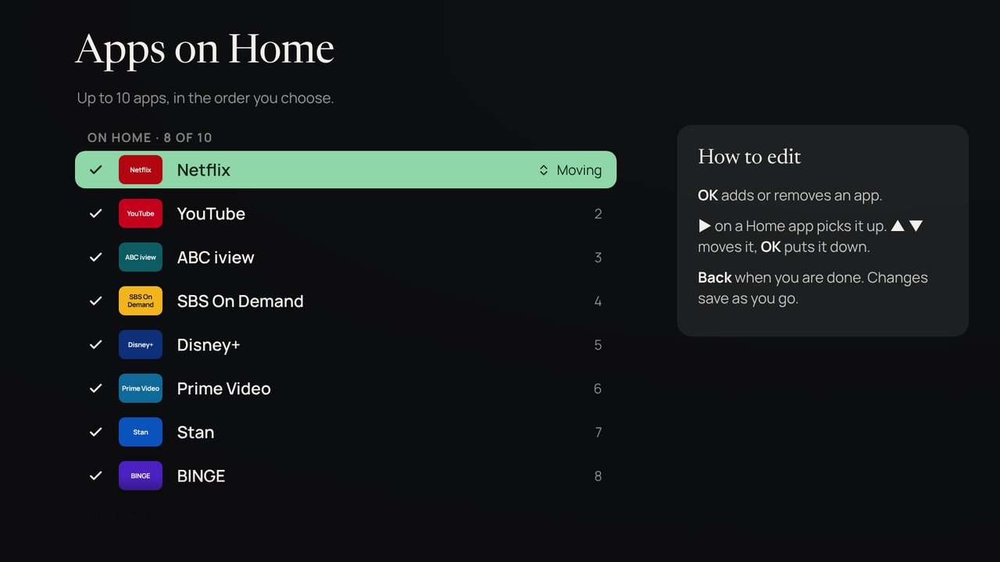

# Serif Home

A quiet home screen for the **Samsung Serif**: the time, your apps, and nothing else. No ad rows, no sponsored tiles, no tracking. It runs as your own app on the TV, signed with your own Samsung certificate, and works with the normal remote.

Built for a **2024 Serif (QA55LS01DAWXXY) on firmware T-PTMDUABC-0090-2130.0**, and adapted from [CleanFrame](https://github.com/nthnclrk/CleanFrame), which was built for a 2024 Frame on that same firmware.



*Browser preview. On the TV, tiles show each app's real icon. Without one, they fall back to the coloured name tiles shown here.*

## What this can and can't do

Samsung TVs only run firmware signed by Samsung, so **nobody can replace the TV's operating system** (Tizen). What you *can* do:

| Goal | How | Where |
| --- | --- | --- |
| Stop viewing-data collection and ad profiling | Switch off the privacy settings (5 minutes) | [Debloat guide](docs/debloat-guide.md) |
| Block Samsung ad and tracking servers | DNS blocklist for NextDNS, Pi-hole or AdGuard Home | [Debloat guide](docs/debloat-guide.md#4-block-ad-and-tracking-servers-on-your-network), [`blocklists/`](blocklists/) |
| Replace Smart Hub's ad-filled home with your own screen | Install **Serif Home** using Samsung's developer tools | [Setup guide](docs/setup-guide.md) |
| Make the TV wake to your screen | **Autorun Last App** setting (low risk) | [Setup guide, Stage 7](docs/setup-guide.md#stage-7--make-it-your-everyday-screen-low-risk) |
| Make the remote's Home button open your screen | Undocumented, higher-risk native change, **not included** | [native-home.md](docs/native-home.md) |

## Try it on your computer

You need Node.js 22+ and Python 3.10+.

```bash
npm ci
```

```bash
npm run dev
```

Open <http://127.0.0.1:4795/>. Use the arrow keys as the remote's arrows, **Enter** as OK and **Escape** as Back. The preview uses a sample list of Australian apps. Opening an app only works on the TV.

## Put it on your TV

Follow the **[setup guide](docs/setup-guide.md)**. In short:

1. Turn on Developer Mode on the TV (**Apps → 12345**), then power-cycle it at the wall.
2. Install Tizen Studio, then create your Samsung author and distributor certificates.
3. Copy `signing.example.json` and `device.example.json` into `.local/` and fill them in.
4. Run `npm run package`, then `npm run tv:install`, then `npm run tv:launch`.

| Command | What it does |
| --- | --- |
| `npm run tv:info` | Tests the developer connection and shows the TV's Tizen version and CPU |
| `npm run tv:apps [word]` | Lists installed apps and their IDs, e.g. `npm run tv:apps ambient` |
| `npm run package` | Builds and signs `dist/SerifHome-signed.wgt` with your certificate profile |
| `npm run tv:install` | Installs it and confirms it appears in the TV's app list |
| `npm run tv:launch` / `tv:uninstall` | Opens or removes Serif Home |

None of these commands change the Home button or startup settings.

## Using it

| Where | Remote |
| --- | --- |
| Home | **◀ ▶** move between apps, **OK** opens one, **▲** reaches Ambient / All apps / Settings, **Back** offers Smart Hub or closing |
| All apps | Arrows move around the grid, **OK** opens, **▲** from the top row reaches **Edit Home** |
| Edit Home | **OK** adds or removes an app, **▶** picks up a Home app, **▲ ▼** move it, **OK** puts it down |
| Settings | **▲ ▼** choose a row, **◀ ▶** change it. Changes apply and save immediately |

Settings include six backgrounds (Graphite, Eucalypt, Moreton Bay, River dusk, Paper, Black) or your own photo, a 12- or 24-hour clock, showing or hiding the date, and shortcuts to Ambient Mode, Smart Hub and TV settings.

<p>


</p>

## Make it yours

- **Your own photo:** save a 1920 × 1080 JPEG as `app/assets/wallpaper.jpg` and choose **Background → My photo**.
- **First-run apps and tile colours:** edit `app/catalog.js`. The TV's real installed-app list always wins.
- **Ambient Mode:** if the Ambient button doesn't appear, find the ID with `npm run tv:apps ambient` and add it to `AMBIENT_IDS` in `app/catalog.js`.
- **Look and layout:** `app/style.css` uses a fixed 1920 × 1080 stage. **Behaviour:** `app/main.js`. **TV calls:** `app/device.js` only.

App code must stay **ES5** (no `let`, `const`, arrow functions or template strings) and avoid CSS `gap` and `inset`. The TV's web engine is older than desktop browsers, and the checks enforce this.

## Checks

```bash
npm run check
```

```bash
npm run check:tools
```

```bash
npm run check:browser
```

- `check`: ES5 lint, manifest, versions, bundled files, CSS rules and font hashes.
- `check:tools`: tests packaging and install against a fake Tizen SDK. No TV needed.
- `check:browser`: drives the launcher like a remote in Chromium, including a simulated TV. Run `npx playwright install chromium` first. Screenshots go to `test-results/`.

None of the checks contact a TV.

## Project layout

| Path | Contents |
| --- | --- |
| `app/` | The TV app: `config.xml`, `index.html`, `style.css`, `main.js`, `device.js`, `catalog.js`, fonts, icon |
| `scripts/` | Preview server, checks, packaging (`package.py`) and TV commands (`tv.py`) |
| `docs/` | [Setup guide](docs/setup-guide.md), [debloat guide](docs/debloat-guide.md), [native Home notes](docs/native-home.md) |
| `blocklists/` | DNS blocklists for Pi-hole and AdGuard Home / NextDNS |
| `.local/`, `dist/` | Your private settings and built packages. Ignored by Git; never commit them |

## Credits and licence

MIT licensed; see [LICENSE](LICENSE). The device adapter, app filtering, install route and much of the setup guidance are adapted from [CleanFrame](https://github.com/nthnclrk/CleanFrame) by Nathan Clark (MIT). The fonts are Newsreader and Manrope, under the SIL Open Font License. See [THIRD_PARTY_NOTICES.md](THIRD_PARTY_NOTICES.md).

Serif Home is an independent project, not affiliated with Samsung or any streaming service. Use it at your own risk.
